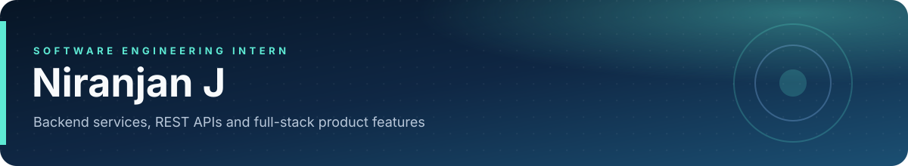
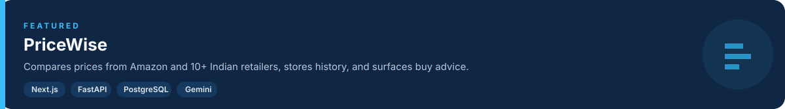
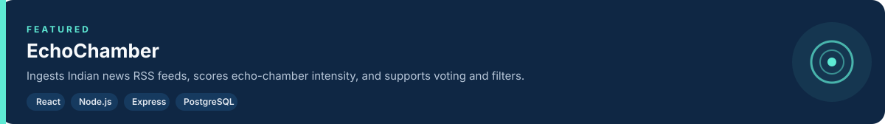

  
   
  
  &nbsp;
  
  &nbsp;
  

 

M.Sc. Software Systems student at SKASC (2023–2028) with hands-on experience developing and deploying full-stack applications and production software. I build Node.js/Express and Java/Spring Boot REST APIs on PostgreSQL, React/Next.js clients, Playwright tests, CI/CD and Linux operations.

 

 

 

