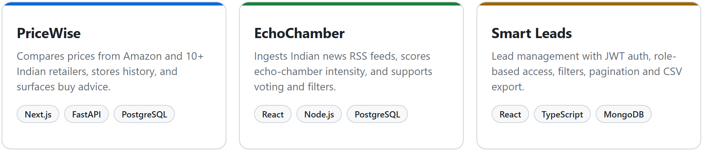
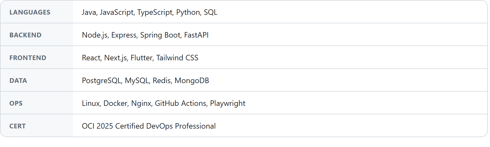

  <h2>Software Engineering Intern</h2>
  
RIO BizSols · M.Sc. Software Systems, SKASC (2023–2028)

  

    
    
    
  

M.Sc. Software Systems student with hands-on experience developing and deploying full-stack applications and production software. I build Node.js/Express and Java/Spring Boot REST APIs on PostgreSQL, React/Next.js clients, Playwright tests, CI/CD and Linux operations.

> **Now — RIO BizSols Pvt. Ltd.** (May 2026 – present) 
> Production EAM/ALM APIs, PostgreSQL, report pipelines, 500,000+ tag search, and Playwright tests in GitHub Actions.

**Selected work**

  <a href="https://github.com/Niranjan-SE/PriceWise">PriceWise</a>
  &nbsp;·&nbsp;
  <a href="https://github.com/Niranjan-SE/Echo-Chamber">EchoChamber</a>
  &nbsp;·&nbsp;
  <a href="https://github.com/Niranjan-SE/Smart-Leads-Dashboard">Smart Leads</a>

**Stack**

